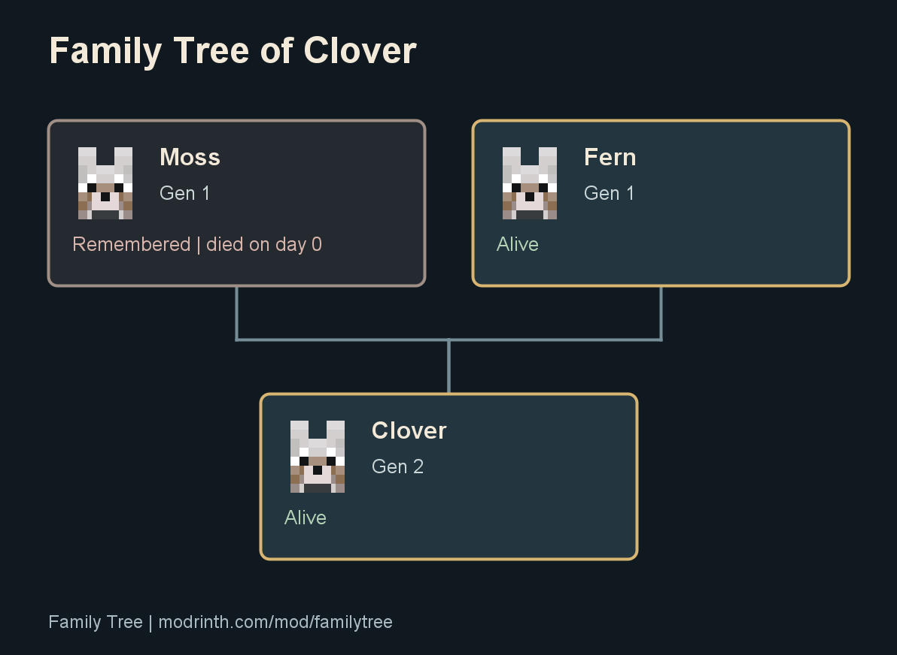
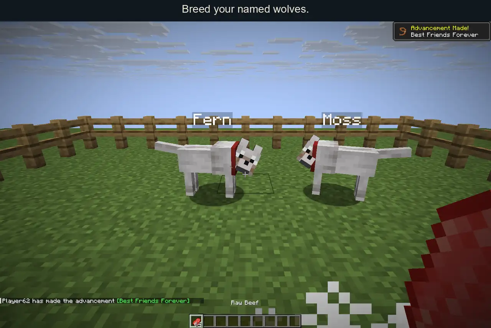

# Family Tree

[](https://modrinth.com/mod/familytree)

Keep the family history of your Minecraft pets. See who their parents were, find a missing pet's last known location, and save a family tree as an image.

[Download Family Tree](https://modrinth.com/mod/familytree/versions)

[Creator guide, demo steps, and downloadable clips](docs/creator-guide.md)

[Download on CurseForge](https://www.curseforge.com/minecraft/mc-mods/family-tree/files). Fabric and NeoForge builds are available.



Keep your first wolf in the family tree after it's gone. Family Tree records parents and descendants as you play, then exports the family as a PNG.



An automated scene in Minecraft 26.2. Vanilla feeding and AI breeding produce the actual puppy. Family Tree records its parents and retains its deceased ancestor. [Landscape video](docs/family-tree-gameplay.mp4) and [vertical video](docs/family-tree-gameplay-vertical.mp4) are ready to share.

## Install

Choose the file that matches both your Minecraft version and mod loader.

| Minecraft | Loader | Java | Extra dependency |
| --- | --- | --- | --- |
| 1.20.1 | Fabric | 17 or newer | [Fabric API](https://modrinth.com/mod/fabric-api) for 1.20.1 |
| 1.20.1 | Forge 47.1.0 or newer | 17 or newer | None |
| 1.21.1 | Fabric | 21 or newer | [Fabric API](https://modrinth.com/mod/fabric-api) for 1.21.1 |
| 1.21.1 | NeoForge 21.1.252 or newer within 21.1 | 21 or newer | None |
| 1.21.11 | Fabric | 21 or newer | Fabric API for 1.21.11 |
| 1.21.11 | NeoForge 21.11.48 or newer within 21.11 | 21 or newer | None |
| 26.1.1 | Fabric | 25 or newer | Fabric API for 26.1.1 |
| 26.1.2 | Fabric | 25 or newer | Fabric API for 26.1.2 |
| 26.2 | Fabric | 25 or newer | Fabric API for 26.2 |
| 26.2 | NeoForge 26.2.0.88 or newer within 26.2 | 25 or newer | None |
| 26.3 | Fabric | 25 or newer | Fabric API for 26.3 |
| 26.3 | NeoForge 26.3.0.37-beta or newer within 26.3 | 25 or newer | Beta loader |

Put the matching jar in `mods/`. Fabric builds use Fabric Loader 0.19.3 for testing. They also run on Quilt Loader 0.30.1 or newer with Fabric API. NeoForge and Forge builds do not need Fabric API.

Install Family Tree on the server for tracking and on your client for the screens. In singleplayer, one installation does both. Use the same Family Tree version on both sides. Players without the client mod can still join and type `/familytree` to browse in chest menus. See [Players without the client mod](#players-without-the-client-mod).

## Start with the pets you already have

1. Join your world and press **H**. You can change the key under Options > Controls > Family Tree.
2. Visit your pets. Family Tree records existing tamed pets as their chunks load. **Find existing pets** also checks the pets currently loaded on the server.
3. Open a pet's tree, or choose a species to see its combined family trees. Breed pets while the mod is installed to record their children's parents automatically.

The tracker covers tamed cats, wolves, parrots, horses, donkeys, mules, llamas, trader llamas, camels, skeleton horses, and zombie horses. Parrots have individual records but cannot breed in vanilla Minecraft. Cat, wolf, and horse portraits match their coat variants, and horse portraits include markings. Wolves in 1.20.1 have a single coat. On 1.21.11, tamed nautiluses and zombie nautiluses are recorded too. They have no portraits; the browser shows the first letter of the name.

Minecraft does not retain older parentage or birth dates. Newly discovered pets start with an unknown family and the discovery day as their recorded birth day. Select a pet and choose **Add parents** to record a family you remember. The picker searches names, species, and UUIDs. Confirm the two parents before saving. The linking stick and age commands also remain available. Horse and donkey parents can link to a mule.

## Browse, find, and remember

Search by pet name or species, filter living or deceased pets, and follow generations through a tree you can pan and zoom. Select a pet to center it, rename it in the tree, or locate it. Custom tree names leave name tags in the world unchanged.

**Locate pet** reports coordinates, dimension, and distance in chat. If the pet is unloaded, it reports the last recorded location and day. It does not load chunks or teleport pets.

Death records retain the pet's name, family, death day, and cause when known. Settings let you show or hide generation, age, birth day, and horse stats. Hide a branch to focus on one part of a large family, then use **Show all** to restore it.


## Players without the client mod

On a server that runs Family Tree, a player with an unmodded client types `/familytree` and gets a chest menu instead of the screens. It lists their pets with spawn egg icons, names, age, and living or deceased status, 45 to a page. Filter by status or species, or search by name in an anvil.

Click a pet to see its parents, grandparents, and children, then click any relative to move through the family. Owners and operators can also:

- locate the pet, with the result in chat,
- rename it in Family Tree through an anvil,
- add or clear its parents with a picker and a confirmation step,
- read its family as a written book.

The menus follow the same permissions and cooldowns as the screens. They never show coordinates, and another player's pets are view-only. Every click is refused before Minecraft moves an item, so players cannot take, move, or copy anything through them, including with shift-click, number keys, dragging, or the offhand key.

Players who have the client mod keep the full screens, and `/familytree menu` opens the chest menu for them too.

Menu text and chat messages follow each player's Minecraft language when Family Tree has a translation, and English otherwise. Server operators can change two settings in `config/familytree-server.properties`, then restart:

- `vanillaMenu=false` turns the chest menu off. `/familytree` then prints the command list.
- `commandAliases=pets,ft` adds `/pets` and `/ft` as other names for `/familytree`. Family Tree skips an alias that another command already uses and logs a warning.

## Horse breeding stats

Family Tree records speed, jump height, and health for horses, donkeys, mules, llamas, trader llamas, camels, skeleton horses, and zombie horses. Speed is in blocks per second, jump in blocks, and health in hearts, using the Minecraft Wiki's conversions. Llamas also show their chest slots.

Each card in a tree shows the stats. A green ▲ marks a stat higher than both parents, and a red ▼ marks one lower than both. Select a foal to compare each value with its parents'. In the browser, **Sort** orders pets by speed, jump, or health.


An automated scene in Minecraft 26.3. Two tamed horses ate golden carrots, and vanilla AI bred them. Ember's jump is lower than both parents'.

Stats are base values, so potion effects don't change them. Family Tree reads them when it records an animal and again whenever the server loads, unloads, or scans it. Horses recorded by an older version get stats the next time they load.

Minecraft treats every camel as tamed, and skeleton trap horses are tamed without an owner. Family Tree records these animals once a player rides or breeds them, and that player becomes their owner in Family Tree. Their owner in Minecraft stays unchanged, and wild camels nobody rides stay out of the tree.

## Export a family tree

Click **Export family tree**, then **Open folder** to find the saved PNG. Export saves a PNG under `screenshots/familytree/` in your Minecraft folder. The image includes the whole visible tree at a fixed, readable scale, regardless of your current zoom or pan. Hidden branches stay hidden. Very large trees need to be narrowed down before export.

Exports include pet names, generations, horse stats, portraits where available, and living or deceased status. They omit player names and coordinates. Nothing uploads automatically.


## Existing families and server permissions

Rename a stick to `familytree` in an anvil. Right-click the first parent, second parent, and child, then confirm in chat. Sneak and right-click a pet to clear its parents after confirmation. Manual links require distinct pets and reject ancestry loops. Horse and donkey parents can link to a mule.

Owners and server operators can locate or edit their pets. Linking two parents requires permission for all three animals. By default, only operators can browse everyone's pets. A server can change `viewPolicy` in `config/familytree-server.properties` to `EVERYONE_ALL` or `OWN_ONLY`, then restart. Public viewing does not grant editing rights or reveal other players' pet locations. The same file holds the chest menu settings described under [Players without the client mod](#players-without-the-client-mod).

[Command reference](docs/commands.md) includes locating, pairing, age corrections, and operator pruning.

## Languages

Family Tree includes English, Simplified Chinese, Traditional Chinese, Japanese, Korean, Russian, Ukrainian, German, French, Italian, Spanish (Spain and Mexico), Brazilian Portuguese, Polish, and Turkish. Everything except English was machine-translated. If a phrase reads wrong in your language, please [open an issue](https://github.com/kharitonov-egor/family_tree/issues) or send a pull request that edits `src/main/resources/assets/familytree/lang/<language>.json`. A test checks that every language file has the same keys and format arguments as `en_us.json`.

## Upgrading to 1.2.0

Existing Family Tree history and custom names remain. Saved records gain one optional `horse_stats` field, and 1.1.0 saves load unchanged. Update the server and clients together because the network channels changed. If you go back to 1.1.0, it keeps every record but drops horse stats on its next save. Minecraft world version restrictions still apply, so each build is for worlds of its own Minecraft version, not for downgrading a newer world.

[Latest release notes](docs/releases/1.2.0.md) | [1.1.0 release notes](docs/releases/1.1.0.md) | [1.0.0 release notes](docs/releases/1.0.0.md)

## Build and test

Install JDK 25, JDK 21, and JDK 17, then use the included Gradle wrapper. The 1.20.1 jars target Java 17 bytecode, and the 1.21.1 and 1.21.11 jars Java 21.

```sh
./gradlew buildAll
./gradlew :1.20.1:build
./gradlew :26.2:build
./gradlew -p neoforge build
./gradlew -p forge build -Pminecraft=1.20.1
```

Fabric jars are in `versions/<minecraft>/build/libs/`, NeoForge jars in `neoforge/build/<minecraft>/libs/`, and Forge jars in `forge/build/<minecraft>/libs/`. `buildAll` runs the shared tests for all twelve targets. Stonecutter generates Fabric sources for each version. NeoForge and Forge compile the generated sources for their selected target with their own event and networking entrypoints. Do not edit generated files under `versions/`.

See [runtime validation](docs/testing.md) for the separate server smoke tests and client demo. [CLAUDE.md](CLAUDE.md) covers the source layout and save compatibility rules.

## License

[MIT](LICENSE)

## Releases and download progress

Version 1.2.0 adds horse breeding stats and builds for Minecraft 1.20.1 and 1.21.11. Update clients and servers together. It preserves existing history, keeps unreadable records in the save, and disables writes to an unsupported future save format. Operator pruning writes a backup before deleting records.

[Release notes](docs/releases/1.2.0.md), [runtime checks](docs/testing.md), and [public download counts](docs/metrics/README.md) describe the release and progress toward 10,000 Modrinth downloads. Run `python scripts/download_counts.py` to update the public counters. The daily GitHub workflow does the same. Repeat downloads and upgrades count toward platform totals.

Build all targets with JDK 25, JDK 21, and JDK 17 installed using `./gradlew buildAll --no-parallel`. Commit the tested source, then run `python scripts/release_manifest.py` to verify jar metadata, Java targets, license, icon, and hashes. Publish the copies under `build/releases/<version>/`.
