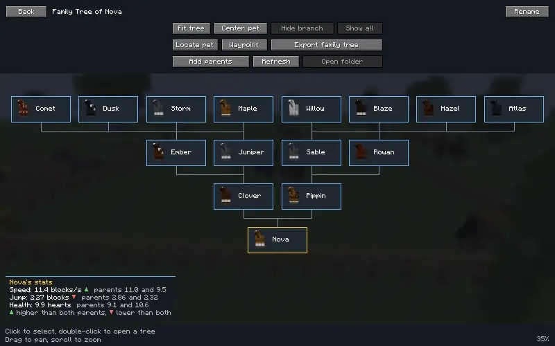
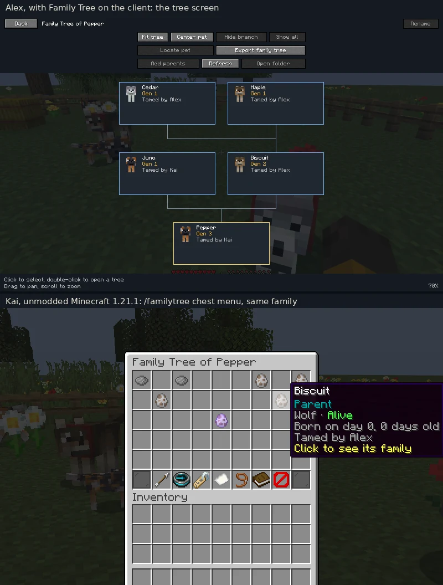
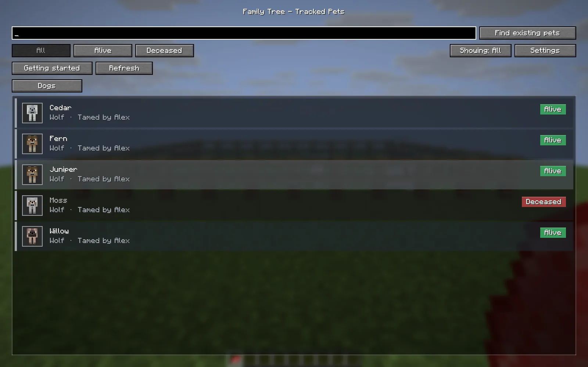
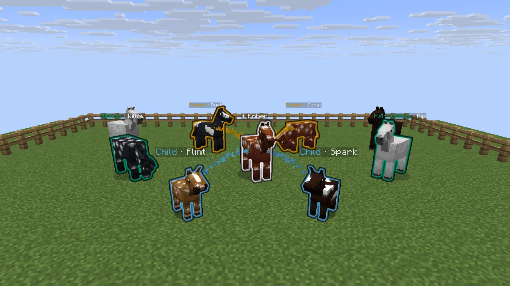
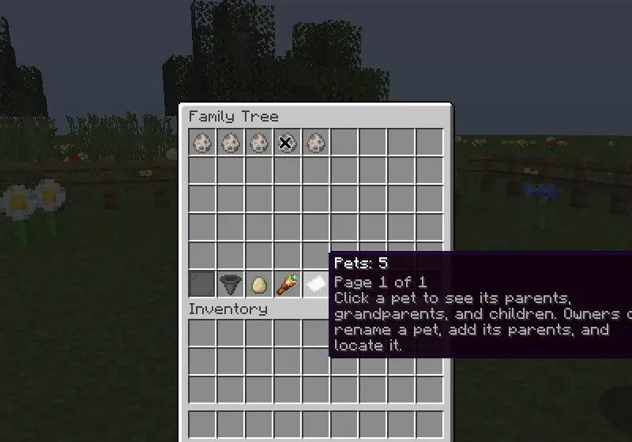
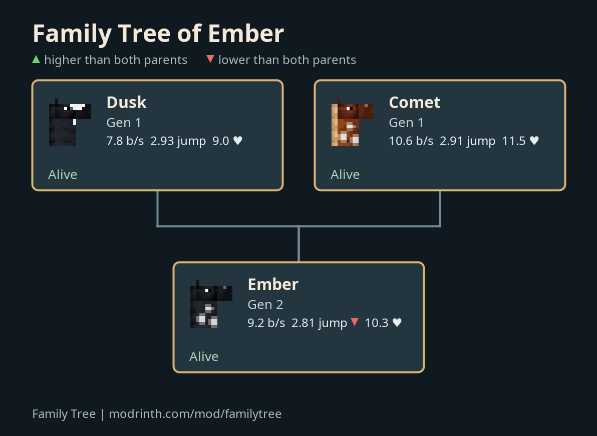
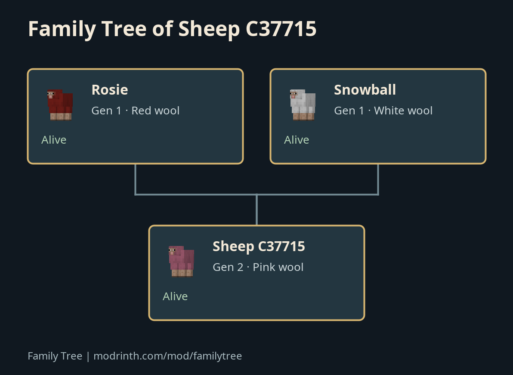
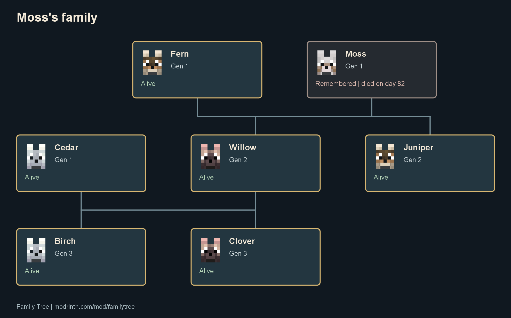
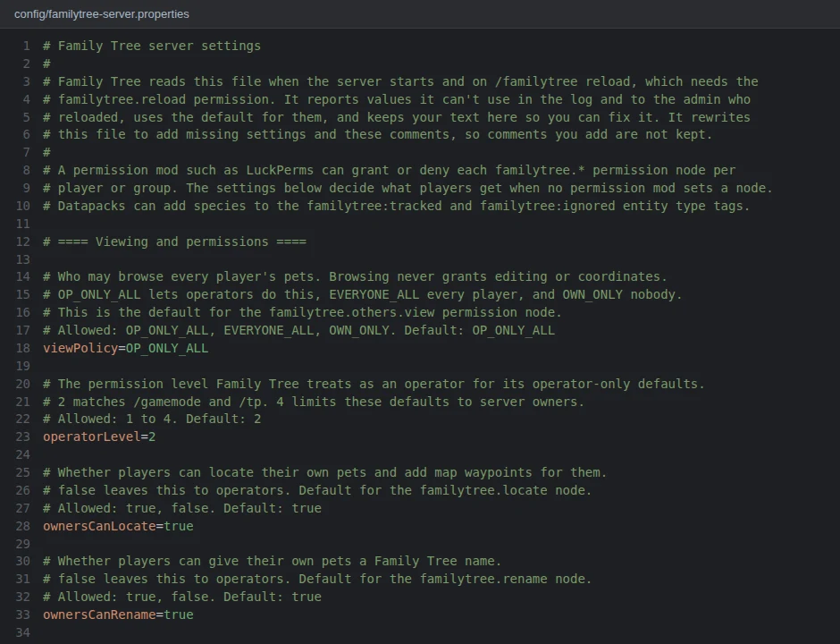

# Family Tree

[](https://modrinth.com/mod/familytree)

See who bred whom in Minecraft. Family Tree records the parents of every pet and animal you breed, so you can follow a family across generations, check whether a foal beat its parents' speed, jump, and health, and see where a pink lamb or a brown panda got its color. It runs in singleplayer and on servers, including for players who join without the mod.

[Download on Modrinth](https://modrinth.com/mod/familytree/versions) or [CurseForge](https://www.curseforge.com/minecraft/mc-mods/family-tree/files). Fabric, NeoForge, and Forge builds are available.

[Creator guide, demo ideas, and the showcase clip](docs/creator-guide.md)



Four generations of horses in Minecraft 26.3. Vanilla AI bred every foal in an automated scene. The script tamed and named the eight founders and grew each foal up before the next generation. The [showcase clip](docs/launch/family-tree-showcase.mp4) and [vertical version](docs/launch/family-tree-showcase-vertical.mp4) are ready to share.



A Fabric 1.21.1 dedicated server running Family Tree 1.3.0 with two players online. Alex has the mod and sees the tree screen. Kai joined with unmodded Minecraft and uses `/familytree`. See [Players without the client mod](#players-without-the-client-mod).

## Install

Choose the file that matches both your Minecraft version and mod loader.

| Minecraft | Loader | Java | Extra dependency |
| --- | --- | --- | --- |
| 1.20.1 | Fabric | 17 or newer | [Fabric API](https://modrinth.com/mod/fabric-api) for 1.20.1 |
| 1.20.1 | Forge 47.1.0 or newer | 17 or newer | None |
| 1.21.1 | Fabric | 21 or newer | [Fabric API](https://modrinth.com/mod/fabric-api) for 1.21.1 |
| 1.21.1 | NeoForge 21.1.252 or newer within 21.1 | 21 or newer | None |
| 1.21.4 | Fabric | 21 or newer | Fabric API for 1.21.4 |
| 1.21.4 | NeoForge 21.4.161 or newer within 21.4 | 21 or newer | None |
| 1.21.5 | Fabric | 21 or newer | Fabric API for 1.21.5 |
| 1.21.5 | NeoForge 21.5.101 or newer within 21.5 | 21 or newer | None |
| 1.21.6, 1.21.7, 1.21.8 | Fabric, one file for all three | 21 or newer | Fabric API for your version |
| 1.21.8 | NeoForge 21.8.57 or newer within 21.8 | 21 or newer | None |
| 1.21.9, 1.21.10 | Fabric, one file for both | 21 or newer | Fabric API for your version |
| 1.21.10 | NeoForge 21.10.64 or newer within 21.10 | 21 or newer | None |
| 1.21.11 | Fabric | 21 or newer | Fabric API for 1.21.11 |
| 1.21.11 | NeoForge 21.11.48 or newer within 21.11 | 21 or newer | None |
| 26.1.1 | Fabric | 25 or newer | Fabric API for 26.1.1 |
| 26.1.2 | Fabric | 25 or newer | Fabric API for 26.1.2 |
| 26.2 | Fabric | 25 or newer | Fabric API for 26.2 |
| 26.2 | NeoForge 26.2.0.88 or newer within 26.2 | 25 or newer | None |
| 26.3 | Fabric | 25 or newer | Fabric API for 26.3 |
| 26.3 | NeoForge 26.3.0.37-beta or newer within 26.3 | 25 or newer | Beta loader |

Minecraft 26.4 is in snapshots. The source builds a Fabric jar for 26.4-snapshot-6 for testing, and no file is published for it. A 26.4 file follows the game's release.

Put the matching jar in `mods/`. Fabric builds use Fabric Loader 0.19.3 for testing. They also run on Quilt Loader 0.30.1 or newer with Fabric API. NeoForge and Forge builds do not need Fabric API.

Install Family Tree on the server for tracking and on your client for the screens. In singleplayer, one installation does both. Use the same Family Tree version on both sides. Players without the client mod can still join and type `/familytree` to browse in chest menus. See [Players without the client mod](#players-without-the-client-mod).

## Start with the pets you already have

1. Join your world and press **H**. You can change the key under Options > Controls > Family Tree.
2. Visit your pets. Family Tree records existing tamed pets as their chunks load. **Find existing pets** also checks the pets currently loaded on the server.
3. Open a pet's tree, or choose a species to see its combined family trees. Breed pets while the mod is installed to record their children's parents automatically.

Pets join on their own: tamed cats, wolves, parrots, horses, donkeys, mules, llamas, trader llamas, camels, skeleton horses, and zombie horses. On 1.21.11 and newer, tamed nautiluses and zombie nautiluses join too. Parrots have individual records but cannot breed in vanilla Minecraft. Other animals join when you breed, name, or add them, as described [below](#animals-you-breed-name-or-add). Portraits show each animal's in-game model, so they match coats, markings, and wool colors. Wolves in 1.20.1 have a single coat.

Minecraft does not retain older parentage or birth dates. Newly discovered pets start with an unknown family and the discovery day as their recorded birth day. Select a pet and choose **Add parents** to record a family you remember. The picker searches names, species, and UUIDs. Confirm the two parents before saving. The linking stick and age commands also remain available. Horse and donkey parents can link to a mule.

## Browse and find

Search by pet name or species, filter living or deceased pets, and follow generations through a tree you can pan and zoom. Select a pet to center it, rename it in the tree, or locate it. Custom tree names leave name tags in the world unchanged.

**Locate pet** reports coordinates, dimension, and distance in chat. If the pet is unloaded, it reports the last recorded location and day. It does not load chunks or teleport pets.

Death records retain the pet's name, family, death day, and cause when known. Settings let you show or hide generation, age, birth day, and horse stats. Hide a branch to focus on one part of a large family, then use **Show all** to restore it.

Ages and birth days count world days. A world day is 24,000 ticks, or 20 minutes of the world running. Sleeping and `/time` move the sun without aging animals, so an age can trail the day count Minecraft shows. Family Tree keeps this clock because it never runs backward: `/time set` can't make an animal younger or put its birth in the future.



## See relatives in the world

Hold the grave accent key (`` ` ``, left of 1) and look at an animal Family Tree records. Its relatives that are loaded nearby glow in a color for their relation, with a label such as "Parent · Comet" or "Half sibling · Pip", and particle lines lead from its parents to it and on to its children. Only you see them. Labels cover parents, children, siblings, half siblings, grandparents, and grandchildren. The server applies the same `viewPolicy` as the screens, so another player's pet you can't open stays dark. Settings can turn the key or the lines off.



## Players without the client mod

On a server that runs Family Tree, a player with an unmodded client types `/familytree` and gets a chest menu instead of the screens. It lists their pets with spawn egg icons, names, age, and living or deceased status, 45 to a page. Filter by status or species, or search by name in an anvil.



Kai's unmodded Minecraft 1.21.1 client on a Fabric server running Family Tree 1.3.0, with real clicks. The server console summoned and named the wild wolves and grew one up. The players tamed and fed them, and vanilla AI bred the puppies.

Click a pet to see its parents, grandparents, and children, then click any relative to move through the family. Owners and operators can also:

- locate the pet, with the result in chat,
- rename it in Family Tree through an anvil,
- add or clear its parents with a picker and a confirmation step,
- read its family as a written book.

The menus follow the same permissions and cooldowns as the screens. They never show coordinates, and another player's pets are view-only. Every click is refused before Minecraft moves an item, so players cannot take, move, or copy anything through them, including with shift-click, number keys, dragging, or the offhand key.

Players who have the client mod keep the full screens, and `/familytree menu` opens the chest menu for them too.

Menu text and chat messages follow each player's Minecraft language when Family Tree has a translation, and English otherwise. Server operators can change these settings in `config/familytree-server.properties`, then run `/familytree reload`:

- `vanillaMenu=false` turns the chest menu off. `/familytree` then prints the command list.
- `commandAliases=pets,ft` adds `/pets` and `/ft` as other names for `/familytree` after `/reload` or a restart. Family Tree skips an alias that another command already uses and logs a warning.
- `serverLanguage=en_us` answers every player in one language instead of their own, including players with the client mod. Minecraft's own words, such as species names, stay in each player's language.

## Horse breeding stats

Family Tree records speed, jump height, and health for horses, donkeys, mules, llamas, trader llamas, camels, skeleton horses, and zombie horses. Speed is in blocks per second, jump in blocks, and health in hearts, using the Minecraft Wiki's conversions. Llamas also show their chest slots.

Each card in a tree shows the stats. A green ▲ marks a stat higher than both parents, and a red ▼ marks one lower than both. Select a foal to compare each value with its parents'. In the browser, **Sort** orders pets by speed, jump, or health.



An automated scene in Minecraft 26.3. Two tamed horses ate golden carrots, and vanilla AI bred them. Ember's jump is lower than both parents'.

Stats are base values, so potion effects don't change them. Family Tree reads them when it records an animal and again whenever the server loads, unloads, or scans it. Horses recorded by an older version get stats the next time they load.

Minecraft treats every camel as tamed, and skeleton trap horses are tamed without an owner. Family Tree records these animals once a player rides or breeds them, and that player becomes their owner in Family Tree. Their owner in Minecraft stays unchanged, and wild camels nobody rides stay out of the tree.

## Animals you breed, name, or add

Family Tree also records cows, mooshrooms, sheep, pigs, chickens, rabbits, goats, foxes, axolotls, frogs, bees, turtles, pandas, ocelots, hoglins, striders, sniffers, armadillos, and breedable animals from other mods. Wild animals stay out of the history until a player does one of these things:

- Breeds them. The baby and both parents join, and the player who fed them owns them in Family Tree. Later babies of a recorded family join even when nobody fed the parents.
- Uses a name tag on one. The player who named it owns it.
- Clicks one with the linking stick. The player who clicked owns it, and it becomes the next pet in the linking selection.

A baby belongs to its parents' owner when the parents already have one. Frogs, sniffers, and turtles hatch from spawn or eggs, so Minecraft never links their babies to the parents. Breeding frogs, sniffers, or turtles still adds both parents for the player. Name or add the hatchlings, then use **Add parents**.

Cards, the details panel, and exports show each animal's variant: axolotl, mooshroom, frog, and llama colors, wool color, panda genes, and rabbit and fox types. On Minecraft 1.21.5 and newer, cows, pigs, and chickens show their warm, cold, or temperate variant. A gold ★ marks a rare variant: a blue axolotl, a brown mooshroom, or a brown panda. Select a baby to compare its variant with its parents'. The panel explains surprises, for example that the parents' wool colors mixed, that a panda shows a gene both parents carried hidden, or that a bred axolotl turned blue, which happens about 1 time in 1,200.

Unnamed animals other than pets are named after their species with a short code, such as "Sheep 3F2A1C". The pet names such as Biscuit stay free for pets. When the history holds more than one kind of animal, the browser shows tabs for Pets, Farm, Wildlife, and Modded, and the species buttons follow the selected tab.



An automated scene in Minecraft 26.3. The player named two sheep with name tags and fed them wheat. Vanilla AI bred a pink lamb from a red and a white parent, and the lamb kept its automatic name.

Modded animals use the same rules. In a test with Naturalist 2.0.7 on NeoForge 1.21.1, deer named with name tags and fed apples bred through vanilla AI, the fawn joined with both parents, and the deer model appeared in the browser, tree, and export. Other animal mods have not been tested. Mods that store variants their own way show no variant text.

### Server settings for animals

`config/familytree-server.properties` decides which new animals join. Settings never remove history; animals already recorded keep their record up to date. Run `/familytree reload` or restart the server after editing the file. Datapacks and KubeJS can also choose species with the `familytree:tracked` and `familytree:ignored` entity type tags. The settings file wins when they disagree, as [Family Tree on servers](docs/servers.md#datapack-tags) explains.

| Setting | Default | What it does |
| --- | --- | --- |
| `trackFarmAnimals` | `true` | Cows, mooshrooms, sheep, pigs, chickens, rabbits, and goats |
| `trackWildlife` | `true` | Foxes, axolotls, frogs, bees, turtles, pandas, ocelots, hoglins, striders, sniffers, armadillos, and other vanilla animals |
| `trackModdedAnimals` | `true` | Breedable animals from other mods |
| `trackedSpecies` | empty | Comma-separated species to record even when their category is off, such as `minecraft:fox` |
| `ignoredSpecies` | empty | Comma-separated species to never record. This also stops new pets of that species. |
| `farmRecordLimit` | `5000` | How many unnamed animals other than pets the history keeps, from 0 to 50,000. At the limit, breeding stops adding them and tells the breeder once. Pets and named animals are always recorded. |
| `autoPruneFarmRecords` | `false` | When the limit is reached, save a JSON backup in `familytree-backups/`, then delete the oldest deceased unnamed animals other than pets until three quarters of the limit remain |

Automatic cleanup never deletes pets, named animals, or living animals, and it removes animals without recorded children before parents. Each cleanup writes a full backup of the history, about 2.3 MB at 5,000 records, and the backups stay until you delete them. `/familytree prune farm` runs the same cleanup by hand for all deceased unnamed animals other than pets.

## Export a family tree

Click **Export family tree**, then **Open folder** to find the saved PNG. Export saves a PNG under `screenshots/familytree/` in your Minecraft folder. The image includes the whole visible tree at a fixed, readable scale, regardless of your current zoom or pan. Hidden branches stay hidden. Very large trees need to be narrowed down before export.

Exports include pet names, generations, variants, horse stats, portraits, and living or deceased status. They omit player names and coordinates. Nothing uploads automatically. Cat, wolf, and horse portraits in exports come from their textures. Other animals' portraits are copied from the in-game model, so the screen briefly shows them while the image is prepared.



## Works with

These mods are optional. Family Tree doesn't bundle them and starts without them.

| Mod | What Family Tree adds | Tested with |
| --- | --- | --- |
| [Jade](https://modrinth.com/mod/jade) | Looking at a tracked animal shows its Family Tree name, parents, generation, and horse stats beside its parents' | Jade 26.3.5 on Fabric 26.3, 19.3.2 on Fabric 1.21.8, 15.10.6 on NeoForge 1.21.1, 17.3.0 on NeoForge 1.21.4, 11.13.3 on Forge 1.20.1 |
| [WTHIT](https://modrinth.com/mod/wthit) | The same tooltip lines | WTHIT 18.2.2 on Fabric 1.21.11, 12.10.2 on NeoForge 1.21.1 |
| [JourneyMap](https://modrinth.com/mod/journeymap) | **Waypoint** in the tree screen adds a waypoint at the pet | JourneyMap 6.0.10 on Fabric 26.3, 6.0.0-beta.52 on Fabric 1.21.8, 6.0.9 on NeoForge 1.21.1, 6.0.0-beta.47 on NeoForge 1.21.4, 6.0.7 on Forge 1.20.1 |
| [Xaero's Minimap](https://modrinth.com/mod/xaeros-minimap) | **Waypoint** shares the pet's position in chat. Xaero's **Add** link opens its waypoint form, filled in with the pet's name and position | Xaero's Minimap 26.6.2 on Fabric 26.3, 26.6.0 on Fabric 1.21.8, NeoForge 1.21.1, and Forge 1.20.1, 26.5.0 on NeoForge 1.21.4 |
| [Mod Menu](https://modrinth.com/mod/modmenu) | Its Configure button opens Family Tree's settings | Mod Menu 21.0.0 on Fabric 26.3, 17.0.1 on Fabric 1.21.11, 15.0.2 on Fabric 1.21.8 |

NeoForge's and Forge's mod list Config button opens the same settings. Family Tree compiles against Jade, WTHIT, Mod Menu, and the JourneyMap API for every target where those mods exist. WTHIT has no build for Minecraft 26.3 yet. JourneyMap's builds for 1.21.4 to 1.21.10 and 26.1.1 are 6.0.0 betas with an older API, which Family Tree also supports.

Tooltips show only what the player could open in Family Tree's own screens: pets the server's `viewPolicy` hides stay hidden, and coordinates never appear. Waypoints follow the same rule as **Locate pet**, so only the pet's owner or an operator can add one.

### For pack authors

- Install Jade or WTHIT on the server as well as the clients. The server then sends family details for any animal a player looks at. A client on a server without them only knows the pets from its last Family Tree screen.
- JourneyMap, Xaero's Minimap, and Mod Menu are client-side for this.
- Client settings live in `config/familytree-client.properties`. The server's `viewPolicy` lives in `config/familytree-server.properties`.
- The tooltip lines follow the client's **Show generation** and **Show horse stats** settings. Jade lists them as "Family Tree pets" in its plugin settings.

## Send feedback

**Send feedback** in the browser and on the Getting started screen opens a form for a message to the developer, with an optional contact field if you'd like a reply. The form lists everything that will be sent: your message, the contact if you give one, the Family Tree, Minecraft, and loader versions, and the game language. Nothing is sent until you press **Send**, and Family Tree never sends anything on its own or in the background. The feedback server uses your IP address only to limit spam and leaves it out of the email. [The endpoint's source](tools/feedback-endpoint/) is in this repository.

## Existing families and server permissions

Rename a stick to `familytree` in an anvil, or to the name in the server's `linkingStickName` setting. Right-click the first parent, second parent, and child, then confirm in chat. Clicking an animal other than a pet that isn't in the history yet adds it for you first. Sneak and right-click a pet to clear its parents after confirmation. Manual links require distinct pets and reject ancestry loops. Horse and donkey parents can link to a mule.

Owners and server operators can locate or edit their pets. Linking two parents requires permission for all three animals. By default, only operators can browse everyone's pets. A server can change `viewPolicy` in `config/familytree-server.properties` to `EVERYONE_ALL` or `OWN_ONLY`, then run `/familytree reload`. Public viewing does not grant editing rights or reveal other players' pet locations. The same file holds the chest menu settings described under [Players without the client mod](#players-without-the-client-mod).

[Command reference](docs/commands.md) includes locating, pairing, age corrections, and operator pruning.

## Running a server

[Family Tree on servers](docs/servers.md) is the guide for server owners and modpack authors.

- LuckPerms and other permission mods can grant or deny each action through `familytree.*` permission nodes, such as `familytree.rename`, `familytree.others.view`, and `familytree.prune`. Without a permission mod, Family Tree uses operator levels exactly as 1.3.0 did.
- `config/familytree-server.properties` explains every setting in a comment with its default and allowed values. `/familytree reload` reads it again and names any value it can't use, and `/familytree settings` shows what differs from the defaults.
- Settings cover cooldowns, which owner actions need an operator, the linking stick's name, the chat language, and more.
- Family Tree was tested on dedicated Fabric, NeoForge, and Forge servers with clients with and without the mod, and with LuckPerms, spark, Lithium, FerriteCore, ModernFix, C2ME, ServerCore, Chunky, and other common server mods. The guide lists the versions and one known LuckPerms problem on NeoForge 1.21.1.



## Paper and Spigot servers

Servers that run Paper, Spigot, or Purpur can use the Family Tree plugin instead of the mod. It is one jar, tested on ten Minecraft versions from 1.20.1 to 26.3, and players install nothing. [Family Tree for Paper and Spigot](docs/plugin.md) covers installing it, the tested versions, and how it differs from the mod.

- It records the same animals, with the same `/familytree` commands, chest menus, permission nodes, settings, and 15 languages.
- It keeps history in the mod's `familytree.dat`, so a world keeps its families when it moves between the mod and the plugin.
- Players who have the client mod get its full screens on a plugin server.

## Languages

Family Tree includes English, Simplified Chinese, Traditional Chinese, Japanese, Korean, Russian, Ukrainian, German, French, Italian, Spanish (Spain and Mexico), Brazilian Portuguese, Polish, and Turkish. Everything except English was machine-translated. If a phrase reads wrong in your language, please [open an issue](https://github.com/kharitonov-egor/family_tree/issues) or send a pull request that edits `src/main/resources/assets/familytree/lang/<language>.json`. A test checks that every language file has the same keys and format arguments as `en_us.json`.

## Upgrading to 1.3.0

Existing Family Tree history and custom names remain, and 1.2.0 saves load unchanged. Saved records gain one optional `variant_origin` field. Update the server and clients together because the snapshot and rename result channels changed. If you go back to 1.2.0, it keeps every record, including farm animals and other new species, and drops `variant_origin` on its next save. Minecraft world version restrictions still apply, so each build is for worlds of its own Minecraft version, not for downgrading a newer world.

[Latest release notes](docs/releases/1.3.0.md) | [1.2.0 release notes](docs/releases/1.2.0.md) | [1.1.0 release notes](docs/releases/1.1.0.md) | [1.0.0 release notes](docs/releases/1.0.0.md)

## Build and test

Install JDK 25, JDK 21, and JDK 17, then use the included Gradle wrapper. The 1.20.1 jars target Java 17 bytecode, and the 1.21.x jars Java 21.

```sh
./gradlew buildAll
./gradlew :1.20.1:build
./gradlew :26.2:build
./gradlew -p neoforge build
./gradlew -p forge build -Pminecraft=1.20.1
./gradlew -p paper build
```

Fabric jars are in `versions/<minecraft>/build/libs/`, NeoForge jars in `neoforge/build/<minecraft>/libs/`, Forge jars in `forge/build/<minecraft>/libs/`, and the Paper and Spigot plugin in `paper/build/libs/`. `buildAll` runs the shared tests for all twenty-one targets, including the Fabric 26.4-snapshot-6 build, which `./gradlew :26.4-snapshot-6:build` builds alone and which needs Fabric Loader 0.20.1. Stonecutter generates Fabric sources for each version. NeoForge and Forge compile the generated sources for their selected target with their own event and networking entrypoints. Do not edit generated files under `versions/`.

See [runtime validation](docs/testing.md) for the separate server smoke tests and client demo. [CLAUDE.md](CLAUDE.md) covers the source layout and save compatibility rules.

## License

[MIT](LICENSE)

## Releases and download progress

Version 1.3.0 records every breedable animal with inherited variants, adds chest menus for players without the client mod, 14 translations, Jade, WTHIT, and map waypoint support, and builds for Minecraft 1.21.4 to 1.21.10. Update clients and servers together. It preserves existing history, keeps unreadable records in the save, and disables writes to an unsupported future save format. Operator pruning writes a backup before deleting records.

[Release notes](docs/releases/1.3.0.md), [runtime checks](docs/testing.md), and [public download counts](docs/metrics/README.md) describe the release and progress toward 10,000 Modrinth downloads. Run `python scripts/download_counts.py` to update the public counters. The daily GitHub workflow does the same. Repeat downloads and upgrades count toward platform totals.

Build all targets with JDK 25, JDK 21, and JDK 17 installed using `./gradlew buildAll --no-parallel`. Commit the tested source, then run `python scripts/release_manifest.py` to verify jar metadata, Java targets, license, icon, and hashes. Publish the copies under `build/releases/<version>/`.
