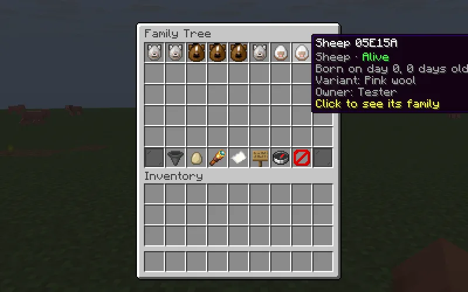
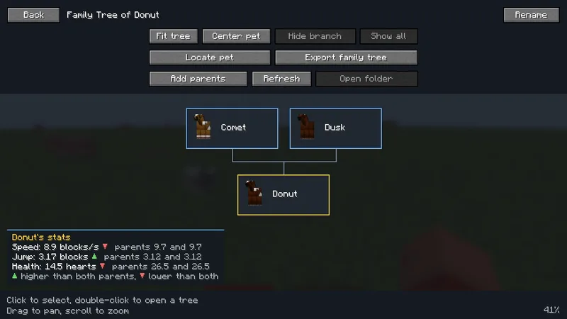

# Family Tree for Paper and Spigot

Family Tree also comes as a server plugin for Paper, Spigot, and Paper forks such as Purpur. It records the same animals as the mod, keeps the same history file, and gives players the same `/familytree` command and chest menus. Players don't install anything. Players who do have the Family Tree client mod get its full screens on a plugin server too.

## Install

1. Download `familytree-<version>+plugin.jar` and put it in the server's `plugins/` folder.
2. Restart the server. Family Tree writes `plugins/FamilyTree/config.yml` with a comment above every setting.
3. Players type `/familytree`.



The plugin has no dependencies. It needs the Java version the server already needs: 17 for 1.20.1, 21 for 1.21.x, and 25 for 26.x.

## Supported servers

One jar covers every version below. Each one marked Yes passed the checks under [Testing](#testing) on a real server with an unmodded client.

| Minecraft | Paper | Spigot |
| --- | --- | --- |
| 26.3 | Yes | Yes |
| 26.2 | Yes | Not tested |
| 26.1.2 | Yes | Not tested |
| 1.21.11 | Yes | Yes |
| 1.21.10 | Yes | Not tested |
| 1.21.8 | Yes | Not tested |
| 1.21.5 | Yes | Not tested |
| 1.21.4 | Yes | Not tested |
| 1.21.1 | Yes | Not tested |
| 1.20.1 | Yes | Yes |

Purpur 26.3 passed the same checks. Leaf and other Paper forks run Paper's code and API, so they should work like Paper, but weren't tested. Patches between the listed versions, such as 1.21.6 or 26.1.1, use the same API and probably work, but weren't tested. Folia is not supported, and Folia refuses to load the plugin. Servers that load both mods and plugins, such as Arclight and Mohist, should use the mod instead.

## Architecture decision

Family Tree's plugin is one jar built against the Bukkit and Spigot API. It does not use server internals, so the same file runs on Spigot, Paper, and Paper forks such as Purpur, on every Minecraft version listed under supported versions.

### What servers run

bStats' global Bukkit charts on October 31, 2026 counted about 187,000 servers:

| Server software | Servers |
| --- | --- |
| Paper | 135,245 |
| Purpur | 16,226 |
| Spigot | 10,800 |
| Leaf | 4,323 |
| Folia | 1,359 |

| Minecraft | Servers |
| --- | --- |
| 26.3 | 50,048 |
| 1.21.11 | 41,496 |
| 26.2 | 39,440 |
| 26.1.2 | 12,498 |
| 1.21.4 | 6,419 |
| 1.21.10 | 4,785 |
| 1.21.1 | 4,690 |
| 1.21.8 | 4,651 |
| 1.20.1 | 4,115 |
| 1.20.4 | 1,943 |

26.3, 1.21.11, 26.2, and 26.1.2 hold three quarters of the servers. The rest is spread across the 1.21 patches and 1.20.1. Versions older than 1.20 are mostly 1.8.8 and 1.12.2 PvP servers, which lack most of the animals Family Tree records.

### Options

**Bukkit API only.** One jar covers Spigot, Paper, Purpur, and Leaf, about 90% of the servers above, across 1.20.1 to 26.3. New Minecraft versions usually keep working without a rebuild. The cost is reuse: the mod's event hooks, menus, and text are written against Minecraft classes, so the plugin needs its own versions of them.

**Paper with paperweight-userdev.** The plugin would compile the Stonecutter-generated shared source against Mojang-mapped Paper internals for each Minecraft version, and reuse the save code, menus, commands, and packet handlers. Each version would need its own Paper dev bundle, which downloads and remaps a server jar before the first build. That means at least nine extra builds and one jar per Minecraft version, and a jar built against Paper's internals doesn't load on Spigot. The mixins that record breeding, taming, and name tags don't apply on Paper either, so those would become Bukkit event listeners anyway. CraftBukkit also patches the container and command layers the shared menus and commands depend on.

### Decision

Bukkit API only. One jar reaches more servers, keeps `buildAll` to one fast Java project, and doesn't need a new build for every Minecraft release. The plugin still shares what must match the mod exactly:

- **Logic.** The plugin compiles the mod's Minecraft-free classes from `src/main/java` unchanged: permission nodes and their defaults, server settings, ownership and parent-link validation, ancestry and cycle checks, renaming rules, generated names, variant inheritance, the breeding planner and kinship, horse stat units, tracking rules, animal categories, the farm limit, cooldowns, and language tables. A change to those rules reaches both.
- **Saved history.** The plugin reads and writes the mod's `familytree.dat` format with its own NBT code, using the same `AnimalRecord` field names. A world keeps its history when it moves between the mod and the plugin.
- **Wire format.** The client-mod bridge writes the same payload bytes as the mod's codecs. A test checks the plugin's bytes against the expected bytes in `WireFormatTest`.
- **Translations.** The plugin ships the mod's 15 language files from `src/main/resources`.

Folia is not supported. It runs regions on separate threads and replaces the Bukkit scheduler, so every listener, menu, and save would need region-aware scheduling. Folia is under 1% of servers.

## Moving between the mod and the plugin

The plugin reads and writes the mod's `familytree.dat` with the same fields, in the same place:

| Minecraft | File |
| --- | --- |
| 1.20.1 to 1.21.11 | `world/data/familytree.dat` |
| 26.x | `world/dimensions/minecraft/overworld/data/familytree/familytree.dat` |

A world that ran the mod keeps its history when the server switches to the plugin, and the other way around. On 26.x, the plugin imports the older `data/familytree.dat` once when the newer file doesn't exist yet, and keeps a copy as `familytree.dat.migration-backup`, as the mod does.

Paper and vanilla don't always lay out a world the same way. Fabric 26.3 couldn't open a Paper 26.3 world because of its world generation settings, which has nothing to do with Family Tree. If a whole world won't move, copy only `familytree.dat` to the same path in the other world.

The plugin follows the mod's save rules. A record it can't read stays in the file untouched, and so does any field it doesn't know, so an older plugin keeps a newer mod's data. A file with an unsupported data version, or one that can't be read at all, turns off tracking and edits, and the plugin never overwrites it. An unreadable file is also copied to `familytree.dat.unreadable-<date>_<time>`, and operators see a message when they join. On 26.x, an older file that can't be imported leaves the plugin read-only without creating the newer file, so the next start tries the import again. Pruning writes a JSON backup to `world/familytree-backups/` first and cancels if the backup fails.

## Commands

The plugin has the mod's commands with the same arguments, names, and messages: `/familytree`, `menu`, `list`, `scan`, `locate`, `info`, `pair`, `unpair`, `setage`, `setbirth`, `breed`, `prune`, `reload`, `settings`, and the linking stick's `confirmlink` and `cancellink`. The [command reference](commands.md) describes each one. `commandAliases` adds other names for `/familytree`. A new alias works after `/familytree reload`; removing one needs a restart.

## Permissions

The plugin checks the mod's `familytree.*` nodes through Bukkit's permission API, which LuckPerms provides. [Family Tree on servers](servers.md#permission-nodes) lists them with their defaults.

A node no permission plugin sets falls back to the default its settings give it, as in the mod. With LuckPerms 5.5.71 on Paper 26.3, a non-operator got the chest menu with no nodes set, got the command list instead once `familytree.menu` was false, lost Rename under `ownersCanRename: false` and got it back when LuckPerms granted `familytree.rename`, and could prune once granted `familytree.prune`. That is why `plugin.yml` declares every node with `default: false`: Bukkit and LuckPerms treat a `plugin.yml` default as a set node, which would override settings such as `ownersCanRename=false` and `viewPolicy`. An operator is a player with op, and the console counts as one.

## Settings

`plugins/FamilyTree/config.yml` holds the mod's server settings under the same names and with the same defaults, read and checked by the same code as the mod's `config/familytree-server.properties`. [Family Tree on servers](servers.md#settings) describes each one. Lists can be written either as YAML lists or as comma-separated text. `/familytree reload` reads the file again and reports each value it can't use. Family Tree rewrites the file to add missing settings and comments, keeps your text for values it couldn't use, and moves unknown keys to the end.

Two differences:

- `operatorLevel` doesn't apply. Bukkit tells plugins whether a player is an operator, not at which level.
- `clientMod`, `true` by default, exists only in the plugin. `false` sends players with the client mod to the chest menu like everyone else. The change applies to players who join after a reload.

Datapack tags work as in the mod: a datapack can add species to the `familytree:tracked` and `familytree:ignored` entity type tags.

## Players with the client mod

The plugin registers the mod's network channels and answers with the bytes the mod's server would send, so a player with the client mod gets its screens and keys: the browser on **H**, trees, rename, Add parents, Locate, **Find existing pets**, map waypoints, and the relatives key. `/familytree` prints the command list for them, and `/familytree menu` still opens the chest menu. A test checks every payload the plugin writes against the expected bytes in the mod's own `WireFormatTest`.



Use the client mod release that matches the plugin's version. Family Tree 1.3.0's Fabric client for 26.3 joined a Paper 26.3 server with the plugin and used the browser, the tree, rename, Locate, and Find existing pets. Add parents and waypoints from the mod's screens use the same code and checks as the chest menu and Locate, but weren't tried from a modded client, and no map mod was installed.

The plugin finds players with the client mod from the channels their client announces when it joins. Family Tree 1.4.0's Fabric client for 1.20.1, 1.21.11, and 26.3, its NeoForge client for 1.21.1 and 26.3, and its Forge client for 1.20.1 each joined a plugin server, showed the welcome message, got the key hint from `/familytree`, and lit an animal's relatives with the relatives key. The relatives key follows the mod's rules: the `familytree.relatives` node, `relativesCooldownMillis`, the 64-block range, and `viewPolicy`. A pet the player can't open stays unlit, and so do animals related only through it.

## Differences from the mod

- **Item text on Spigot.** Spigot can't put translatable text on items, so species names, wool colors, and death messages in Spigot's chest menus are in English. Family Tree's own words still follow each player's language, and so does chat everywhere. Paper shows all of it in the player's language.
- **Text entry on older Spigot.** Paper, and Spigot from 1.21, open an anvil for search and rename. Spigot 1.20.1 has no API for an anvil that reads typed text, so players type the name in chat instead, `-` to clear it or `cancel` to stop.
- **Frogs, sniffers, and turtles on Spigot.** Paper reports when frogs, sniffers, and turtles breed, and the plugin records both parents for the player, as the mod does. Spigot reports nothing for them, so on Spigot they need a name tag or the linking stick.
- **Relative markers before 1.21.4.** **Show relatives nearby** marks relatives with dust that only the player sees. The Bukkit API before 1.21.4 can't send it to one player at long range, so on 1.20.1 and 1.21.1 the dust shows only over relatives within 32 blocks. The chat list still names everyone within 64 blocks.
- **Saving.** The plugin saves the history when the server saves the world, every five minutes when it changed, and when the server stops. Encoding runs on the main thread and writing on a background thread.

## Testing

`./gradlew -p paper build` compiles the plugin and runs its tests:

- The storage tests read two real `familytree.dat` files that the mod's smoke runs wrote on 1.21.11 and 26.3, and check that the plugin writes back exactly the NBT the mod wrote. They also cover preserved unreadable records, unknown fields, unsupported versions, unreadable files, the 26.x import, and the JSON backup.
- `WireParityTest` encodes every payload and compares it with the expected bytes in `src/test/java/com/egakh/familytree/network/WireFormatTest.java`. It also fails when those expected bytes change, so the plugin is updated with them.
- The settings, message, and argument tests cover `config.yml`, translation formats, and the plugin's own strings in all 15 languages.

Two scripts run real servers. Both download Paper through PaperMC's API. Spigot needs a jar built with [BuildTools](https://www.spigotmc.org/wiki/buildtools/), passed with `--server-jar`.

```sh
python scripts/plugin_server.py --minecraft 26.3 --smoke --fresh
python scripts/plugin_server.py --minecraft 1.21.11 --software spigot --server-jar spigot-1.21.11.jar --smoke --fresh
python scripts/plugin_server.py --minecraft 1.21.11 --smoke --fresh --seed path/to/mod/world/data/familytree.dat --history 14
python scripts/plugin_client_check.py --minecraft 26.3 --display :66
```

The smoke run loads the development plugin from `paper/src/smoke`, which never enters the release jar. It forces a few chunks to load, spawns owned horses, a camel, an ownerless skeleton horse, sheep, and frogs, and lets vanilla AI breed them. It checks the scan, the animals that must stay out, owners and horse stats, a recorded family that keeps growing without a player, a mixed wool color saved at birth, a suffocation recorded as `inWall`, a name change, and `save-all`. `--history` requires that many records at startup, which checks a restart or a mod world loaded with `--seed`.

The client check starts a server and a vanilla client through portablemc on an Xvfb display and drives the client with xdotool. The player tames two wolves with bones and breeds them with beef, names three sheep with name tags, searches the chest menu, renames a sheep in an anvil, and adds its parents through the picker and confirmation. It then tries shift-click, number keys, double-click, dragging, `Q`, `F`, and closing over the menu, and compares the inventory and offhand before and after. Next it adds a wolf owned by someone else, takes away the player's op, applies `viewPolicy: EVERYONE_ALL` with `/familytree reload`, and checks that the menu offers no Locate, Rename, or Add parents for it and that commands refuse it. Finally it restarts the server and checks the history, names, and parents. Results go to `client-check.txt`, and screenshots to `shots/`.

Results on October 31, 2026, before the 1.4.0 release:

| Server | Smoke | Client check |
| --- | --- | --- |
| Paper 26.3 | Pass | Pass |
| Paper 26.2 | Pass | Pass |
| Paper 26.1.2 | Pass | Pass |
| Paper 1.21.11 | Pass | Pass |
| Paper 1.21.10 | Pass | Pass |
| Paper 1.21.8 | Pass | Pass on the second run. In the first, a wolf walked in front of a sheep and took a name tag click, so the script now freezes the wolves first. |
| Paper 1.21.5 | Pass | Pass |
| Paper 1.21.4 | Pass | Pass |
| Paper 1.21.1 | Pass | Pass |
| Paper 1.20.1 | Pass | Pass |
| Purpur 26.3 | Pass | Pass |
| Spigot 26.3 | Pass | Pass |
| Spigot 1.21.11 | Pass | Pass |
| Spigot 1.20.1 | Pass | Pass, with search and rename typed in chat |

The relatives key and **Show relatives nearby** were checked the same day with a modded and an unmodded client on Paper 26.3, 1.21.11, and 1.20.1, Purpur 26.3, and Spigot 26.3, 1.21.11, and 1.20.1, on a wolf family linked with `/familytree pair`. On Paper 26.3, two foals whose parents belong to another player stayed unlit for their owner and lit up once the owner was an operator.

The smoke runs also covered loading a history the mod wrote: Paper 1.21.11 started on a world seeded with the mod's 1.21.11 smoke file and kept all 14 records, and a restart kept all 20 after the smoke added six. In the other direction, Family Tree 1.3.0 on a Fabric 26.3 server listed all 10 records of a history the plugin wrote on Paper 26.3, with tree names, parents, generations, and wool colors.

## Publishing

`scripts/release_manifest.py` checks the plugin jar along with the mod jars: the license, the icon, `plugin.yml`'s version and `api-version`, the 15 language files and the plugin's own strings, Java 17 bytecode, and no development classes. It copies the jar and its sources jar into `build/releases/<version>/` and adds a manifest entry with the `paper`, `spigot`, and `purpur` loaders and the tested game versions in `PLUGIN_GAME_VERSIONS`. The `bukkit` loader is left out because CraftBukkit without Spigot lacks the chat API the plugin uses.

**Modrinth.** `scripts/publish_modrinth.py --manifest` uploads the plugin to the existing project, `CVQKDAe7`, as one version named "Family Tree <version> for Paper and Spigot". Modrinth shows a project with plugin loaders in its plugin search too, and those downloads count toward the same project. Nothing needs to be created first.

**CurseForge.** CurseForge keeps Bukkit plugins in a separate section, so the plugin needs a new project there. `publish_curseforge.py` skips the plugin jar for that reason. Egor would create a project under Bukkit Plugins with the name, summary, description, logo, MIT license, and categories, and wait for CurseForge's approval. The upload script would then need that project's ID and CurseForge's Bukkit game version IDs, which its game versions API lists under a separate type. Downloads there count separately from the mod project.

**Hangar.** Hangar, at hangar.papermc.io, is PaperMC's own plugin repository, and many Paper and Purpur admins browse it first. Egor would sign in, create a project with a name, category, description, and license, and choose the Paper platform with the tested versions. Hangar lists Paper only; Spigot admins use other sites. Hangar has an API that accepts version uploads with an API key, so a `publish_hangar.py` could upload the jar from the release manifest the way the Modrinth script does.

SpigotMC's resource list is where most Spigot admins look, but it has no upload API, so each release would be posted by hand.
