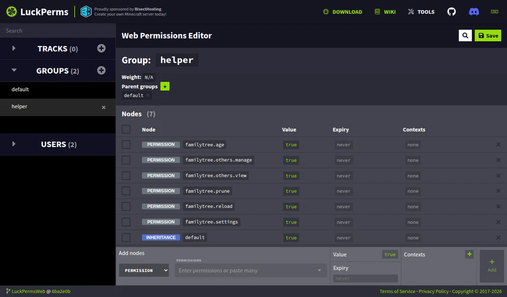
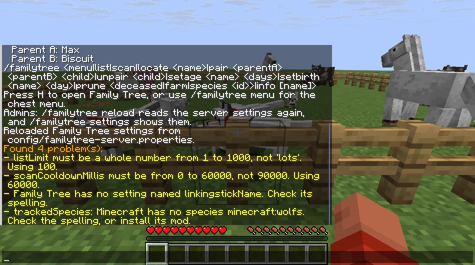
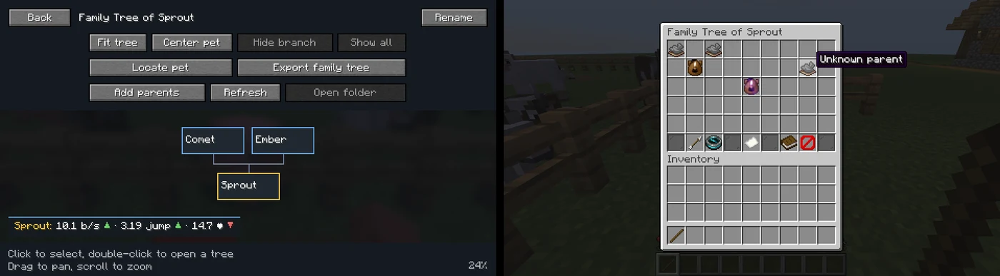

# Family Tree on servers

Install Family Tree on the server for tracking. Players with the client mod get the screens; players without it type `/familytree` for chest menus. This page is for server owners and modpack authors: permission nodes, every server setting, datapack tags, and the setups Family Tree was tested with.

## Admin commands

| Command | Node | What it does |
| --- | --- | --- |
| `/familytree reload` | `familytree.reload` | Reads `config/familytree-server.properties` again. Reports each value it can't use, in the log and to the admin who ran it, and uses the default for that value. |
| `/familytree settings` | `familytree.settings` | Lists the settings that differ from their defaults, which permission API Family Tree uses, and the species in the `familytree:tracked` and `familytree:ignored` tags. |
| `/familytree settings all` | `familytree.settings` | Lists every setting. |

The console can always run both.

## Permission nodes

Family Tree checks these nodes through fabric-permissions-api on Fabric and through PermissionAPI on NeoForge and Forge. LuckPerms hooks into both. Without a permission mod, or when a node is unset, each node falls back to the default in the table, which is what Family Tree 1.3.0 did with operator levels. An operator is a player with permission level 2 or higher, or the level in `operatorLevel`.

| Node | Default | Covers |
| --- | --- | --- |
| `familytree.use` | everyone | `/familytree`, `list`, `info`, the Family Tree screens, and Jade and WTHIT tooltips |
| `familytree.menu` | everyone | The chest menu: `/familytree` without the client mod, and `/familytree menu` |
| `familytree.scan` | everyone | `/familytree scan`, and **Find existing pets** in the screens and the chest menu |
| `familytree.locate` | everyone, or operators with `ownersCanLocate=false` | `/familytree locate`, **Locate pet**, map waypoints, and the last known positions the screens receive |
| `familytree.rename` | everyone, or operators with `ownersCanRename=false` | Tree names from the screens and the chest menu |
| `familytree.parents` | everyone, or operators with `ownersCanEditParents=false` | `pair`, `unpair`, **Add parents**, and confirming links with the linking stick |
| `familytree.age` | everyone, or operators with `ownersCanSetAge=false` | `setage`, `setbirth` |
| `familytree.linkingstick` | everyone | Clicking animals with the linking stick, which also adds animals other than pets |
| `familytree.relatives` | everyone | The relatives key and **Show relatives nearby** in the chest menu. Without it the key shows the permission message and nothing lights up. |
| `familytree.breed` | everyone | `/familytree breed` and **Plan breeding** in the chest menu. The breeding planner screen works from the client's own family list, so it needs no node. |
| `familytree.others.view` | set by `viewPolicy`: operators, everyone, or nobody | Browsing every player's pets |
| `familytree.others.manage` | operators | Locating, renaming, and editing other players' pets. Each action also needs its own node. |
| `familytree.prune` | operators | `/familytree prune deceased`, `farm`, and `species` |
| `familytree.reload` | operators | `/familytree reload` |
| `familytree.settings` | operators | `/familytree settings` |

A player who owns a pet needs only the action's node to act on it. Acting on someone else's pet needs the action's node and `familytree.others.manage`. Browsing never grants editing or coordinates. A player whose nodes deny a subcommand still sees it in tab completion, and running it names the missing node. Two exceptions hide commands instead: denying `familytree.use` removes `/familytree` from the player's commands, and denying `familytree.prune` removes `prune`. `/familytree reload` resends the command list to everyone online. The usage line `/familytree` prints lists only the subcommands the player may run.

With LuckPerms, for example:

```
lp group default permission set familytree.others.view true
lp group helper permission set familytree.others.manage true
lp group helper permission set familytree.prune true
lp user Steve permission set familytree.menu false
```



On Fabric, fabric-permissions-api is optional. Family Tree doesn't bundle it. LuckPerms and most other permission mods include it, and without it Family Tree uses the defaults above.

## Settings

Family Tree writes `config/familytree-server.properties` on first start, with a comment above every setting that gives its default and allowed values. Edit it, then run `/familytree reload` or restart. A 1.3.0 file loads unchanged and gains the new settings with their defaults.

When a value can't be used, Family Tree uses the default, or the nearest allowed number, and keeps your text in the file so you can fix it. Settings it doesn't recognize, such as a misspelled key, stay at the end of the file under "Not recognized". Family Tree rewrites the file to add missing settings and comments, so comments you add yourself are not kept.



| Setting | Default | Allowed | What it does |
| --- | --- | --- | --- |
| `viewPolicy` | `OP_ONLY_ALL` | `OP_ONLY_ALL`, `EVERYONE_ALL`, `OWN_ONLY` | Who may browse every player's pets: operators, everyone, or nobody. Default for `familytree.others.view`. |
| `operatorLevel` | `2` | 1 to 4 | The permission level Family Tree treats as an operator |
| `ownersCanLocate` | `true` | `true`, `false` | `false` leaves locating and waypoints to operators. Default for `familytree.locate`. |
| `ownersCanRename` | `true` | `true`, `false` | `false` leaves renaming to operators. Default for `familytree.rename`. |
| `ownersCanEditParents` | `true` | `true`, `false` | `false` leaves parent edits to operators. Default for `familytree.parents`. |
| `ownersCanSetAge` | `true` | `true`, `false` | `false` leaves age corrections to operators. Default for `familytree.age`. |
| `vanillaMenu` | `true` | `true`, `false` | `false` turns the chest menu off for everyone |
| `commandAliases` | empty | comma-separated names | Extra names for `/familytree`, such as `pets,ft`. Takes effect after `/reload` or a restart. |
| `listLimit` | `100` | 1 to 1000 | Lines `/familytree list` prints |
| `openCooldownMillis` | `500` | 0 to 60000 | Per player: opening the screens or chest menu |
| `scanCooldownMillis` | `2000` | 0 to 60000 | Per player: `/familytree scan` and **Find existing pets** |
| `serverScanCooldownMillis` | `2000` | 0 to 60000 | Shared by all players: time between any two scans |
| `locateCooldownMillis` | `250` | 0 to 60000 | Per player: `/familytree locate`, **Locate pet**, and waypoints |
| `editCooldownMillis` | `250` | 0 to 60000 | Per player: renames, parent and age edits by command or screen, and confirming the linking stick |
| `relativesCooldownMillis` | `200` | 0 to 60000 | Per player: the relatives key and **Show relatives nearby** |
| `linkingStick` | `true` | `true`, `false` | `false` turns the linking stick off |
| `linkingStickName` | `familytree` | 1 to 50 characters | The anvil name that makes a stick the linking stick, ignoring case |
| `linkingSelectionSeconds` | `120` | 10 to 3600 | How long the linking stick keeps a selection |
| `serverLanguage` | `auto` | `auto` or a language code | `auto` uses each player's language for chat and chest menus. A code such as `en_us` uses one language for everyone, with or without the client mod. Minecraft's own words, such as species names and death messages, stay in each player's language, and the client mod's screens follow the player's language. |
| `farmLimitMessage` | `true` | `true`, `false` | Whether a breeder hears once when `farmRecordLimit` stops recording |
| `locateTeleportLink` | `true` | `true`, `false` | Whether operators can click Locate's coordinates to fill in a teleport command |
| `discoverPetsOnLoad` | `true` | `true`, `false` | Whether tamed pets missing from the history join it when their chunk loads |
| `trackFarmAnimals` | `true` | `true`, `false` | Cows, mooshrooms, sheep, pigs, chickens, rabbits, and goats |
| `trackWildlife` | `true` | `true`, `false` | Foxes, axolotls, frogs, bees, turtles, pandas, and other vanilla animals |
| `trackModdedAnimals` | `true` | `true`, `false` | Breedable animals from other mods |
| `trackedSpecies` | empty | species ids | Species to record even when their category is off |
| `ignoredSpecies` | empty | species ids | Species to never record, including new pets |
| `farmRecordLimit` | `5000` | 0 to 50000 | Unnamed animals other than pets the history keeps |
| `autoPruneFarmRecords` | `false` | `true`, `false` | Back up, then delete the oldest deceased unnamed animals other than pets at the limit |

Locate and edit commands from the console or a command block have no cooldown. Every cooldown accepts 0, which turns it off. The server-wide scan cooldown protects busy servers, so keep it unless scans are rare.

## Datapack tags

Two entity type tags choose species from a datapack or KubeJS: `familytree:tracked` records a species even when its category is off, and `familytree:ignored` never records it. Family Tree ships both empty, so other tags can reference them.

```json
{
  "replace": false,
  "values": ["minecraft:bee", "naturalist:snail"]
}
```

Put that file at `data/familytree/tags/entity_type/ignored.json` in a datapack. Minecraft 1.20.1 uses `tags/entity_types/` instead. With KubeJS: `ServerEvents.tags('entity_type', event => event.add('familytree:ignored', 'minecraft:bee'))`. Tags change with `/reload`.

When they disagree, Family Tree decides in this order and stops at the first match:

1. `ignoredSpecies` in the settings file: not recorded.
2. `trackedSpecies` in the settings file: recorded.
3. The `familytree:ignored` tag: not recorded.
4. The `familytree:tracked` tag: recorded.
5. Pets are recorded. Other animals follow `trackFarmAnimals`, `trackWildlife`, and `trackModdedAnimals`.

The settings file is the server owner's, so it wins over a modpack's tags. Like the settings, tags only decide which new animals join. They never remove history.

## Tested servers

Each loader ran a real dedicated server with two offline clients joined at once: Alice with the client mod and Bob with an unmodded client. The server console summoned owned wolves and horses, set two animals in love for each player, and let vanilla AI breed them. LuckPerms nodes were set from the console while both players were online.



Alice, an operator with the client mod, and Bob, on an unmodded client, look at the same foal on the Fabric 1.21.11 test server. Bob owns Sprout, but its other parent is Alice's, so his menu shows it as unknown.

| Server | Clients | Other mods on the server | Result |
| --- | --- | --- | --- |
| Fabric 1.21.11, Loader 0.19.3, Fabric API 0.141.6 | Fabric with Family Tree, vanilla 1.21.11 | LuckPerms 5.5.21, spark 1.10.170, Lithium 0.21.4, FerriteCore 8.2.0, C2ME 0.3.6.0.0, Krypton 0.2.10, Chunky 1.4.55, ServerCore 1.5.15, No Chat Reports 2.18.0, Clumps 29.0.0.1 | Passed |
| Fabric 26.3, Loader 0.19.3, Fabric API 0.165.0 | vanilla 26.3 | LuckPerms 5.5.85 | Passed the node grant and deny checks |
| NeoForge 1.21.1, 21.1.252 | NeoForge with Family Tree, vanilla 1.21.1 | spark 1.10.124, Lithium 0.15.4, FerriteCore 7.0.3, ModernFix 5.27.27, Chunky 1.4.23, C2ME 0.4.0-alpha.0.124, No Chat Reports 2.9.1, Clumps 19.0.0.1 | Passed. LuckPerms and ServerCore could not run, as described below. |
| NeoForge 1.21.11, 21.11.48 | NeoForge with Family Tree, vanilla 1.21.11 | LuckPerms 5.5.21, spark 1.10.170 | Passed |
| Forge 1.20.1, 47.4.28, Java 17 | Forge with Family Tree, vanilla 1.20.1 | LuckPerms 5.4.102, spark 1.10.53, Canary 0.3.3, FerriteCore 6.0.1, ModernFix 5.27.91, Chunky 1.3.146, ServerCore 1.5.2, No Chat Reports 2.2.3, Clumps 12.0.0.4 | Passed |

Every full run on Fabric 1.21.11, NeoForge 1.21.1, and Forge 1.20.1 checked:

- breeding between animals of different players. A wolf of Bob's and a wolf of Alice's had a puppy that both families show, and each player sees the other's animal as an unknown parent under the default `viewPolicy`. When Alice fed one cow and Bob fed its mate, each parent went to the player who fed it.
- the chest menu on the unmodded client, a family with a hidden parent, renaming through the anvil, and the player's inventory staying unchanged.
- the screens on the modded client, for the player's own pets and, as an operator, for everyone's.
- that a player can't locate or edit another player's pet by command.
- the scan cooldown, and `/familytree reload` reporting a bad value while players were online.
- the same history after stopping and starting the server, including a menu rename.
- a Chunky pregeneration of about 1,500 to 2,600 chunks with no errors.

Some checks ran on fewer loaders:

- After `op`, the operator located and relinked another player's pet by command, on Fabric 1.21.11 and NeoForge 1.21.1.
- `viewPolicy=EVERYONE_ALL` applied with `/familytree reload` while players were online, on Fabric 1.21.11 and NeoForge 1.21.1. A 60-second scan cooldown applied the same way on Fabric.
- The linking stick added a wild cow and selected it, on Fabric 1.21.11 and on Forge 1.20.1's item names.
- LuckPerms on Fabric 1.21.11, NeoForge 1.21.11, and Forge 1.20.1: denying `familytree.menu` and `familytree.parents` for one player, and granting `familytree.prune` and `familytree.others.view` to a player who isn't an operator. Fabric 1.21.11 also denied `familytree.rename` and `familytree.linkingstick`, and Rename and Add parents disappeared from that player's chest menu. NeoForge 1.21.11 refused a rename from the modded screen with `familytree.rename` denied. Fabric 26.3 granted `familytree.prune` and denied `familytree.locate`.

### Known problems with other mods

- LuckPerms 5.4.140, the last LuckPerms build for NeoForge 1.21.1, disconnects every player at login with "Invalid player data" on NeoForge 21.1.252 and 21.1.265, with or without Family Tree. Its player data isn't ready when NeoForge asks for it. Family Tree needs NeoForge 21.1.252 or newer on 1.21.1, so its nodes can't use LuckPerms there yet; it falls back to operator levels. LuckPerms works on NeoForge 1.21.11 and 26.x.
- ServerCore 1.5.19 with that LuckPerms build on NeoForge 1.21.1 fails the same way, also without Family Tree.
- ServerCore's breeding cap is off by default. When a server turns it on, babies it prevents are never born, so Family Tree has nothing to record.
- C2ME for NeoForge 1.21.1 is an alpha. It worked in these tests.

## Performance

Measured with spark on the Fabric 1.21.11 server above, with LuckPerms and spark, 5,022 records in the history (5,000 of them synthetic unnamed farm animals in families), 300 farm animals loaded near two players, and both players online. Other jobs kept the host's CPU 80 to 90% busy, so absolute tick times run high.

- Idle: 20 TPS, a median tick of 12.8 ms, and 20.6 ms at the 95th percentile.
- A 94-second profile while both players opened the screens and the chest menu three times, three saves ran, `/familytree list` and `/familytree scan` ran, and a player teleported to load new chunks: Family Tree used 0.40% of the server thread. Entity loading, unloading, and breeding never showed up at spark's 4 ms sampling interval.
- Per action with 5,022 records: opening the screens with every pet visible took about 41 ms of server time, most of it measuring records to split the snapshot into pages; a save took about 30 ms; `/familytree list` took about 25 ms; opening the chest menu took about 21 ms; and a scan took about 3 ms. These run once per action, and the open and scan cooldowns limit how often one player can trigger them. The snapshot cost grows with the number of visible records.
- Memory: the server heap held 261 MB, and Family Tree's own objects took 0.8 MB for 5,022 records.
- With the other server mods added, Chunky generated 2,601 chunks in 7 seconds, and ticks then ran at a 8.5 ms median.

